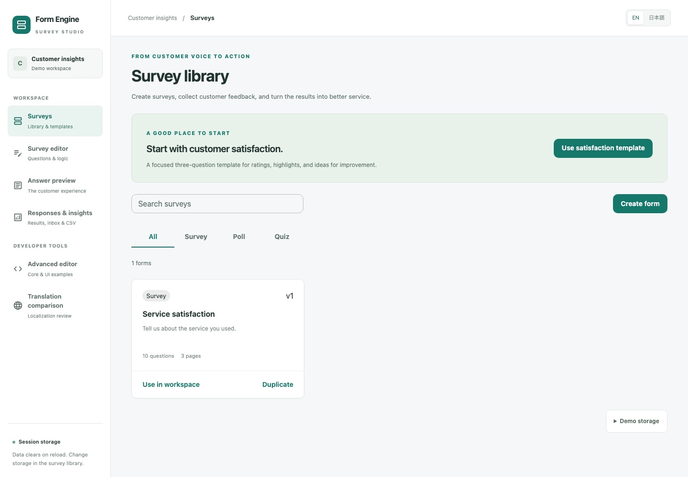
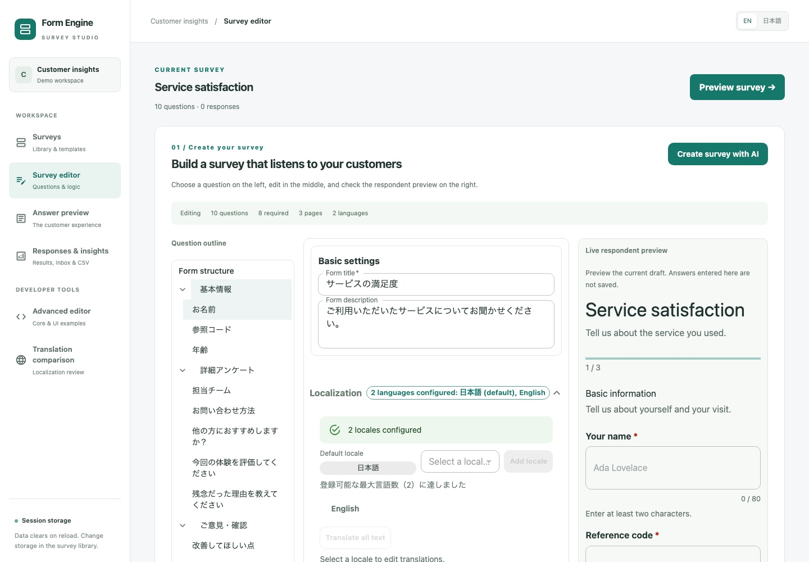
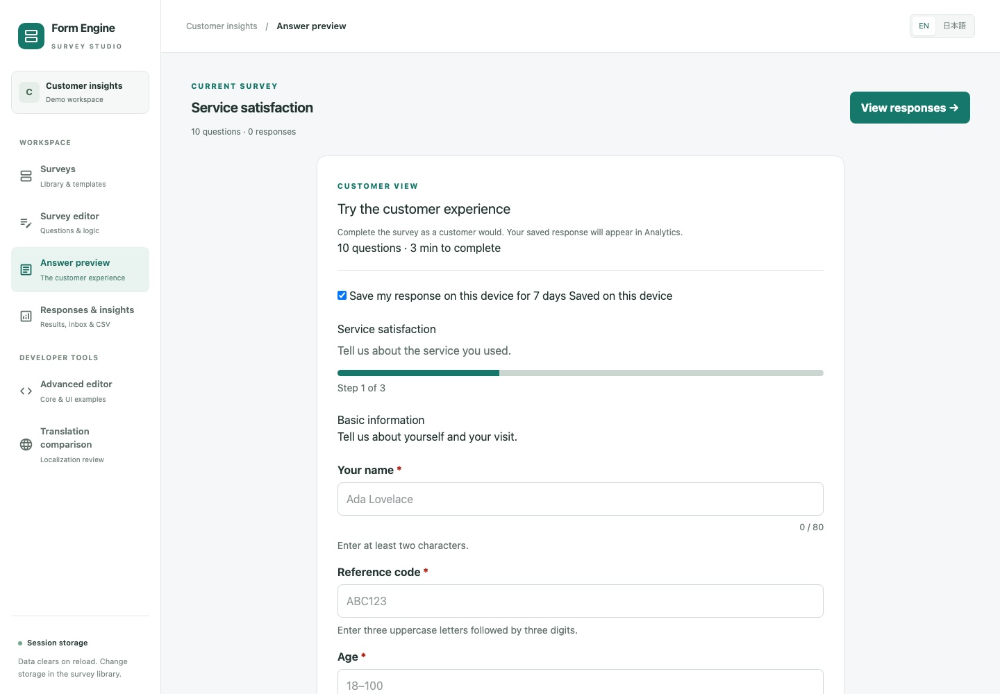
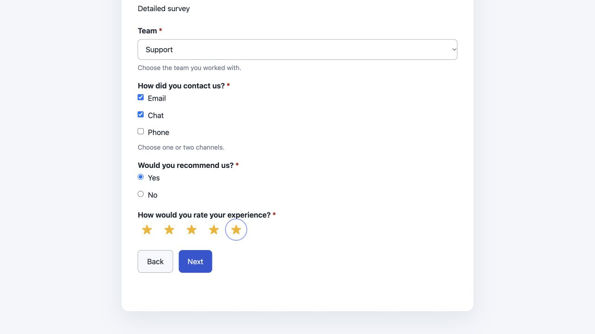
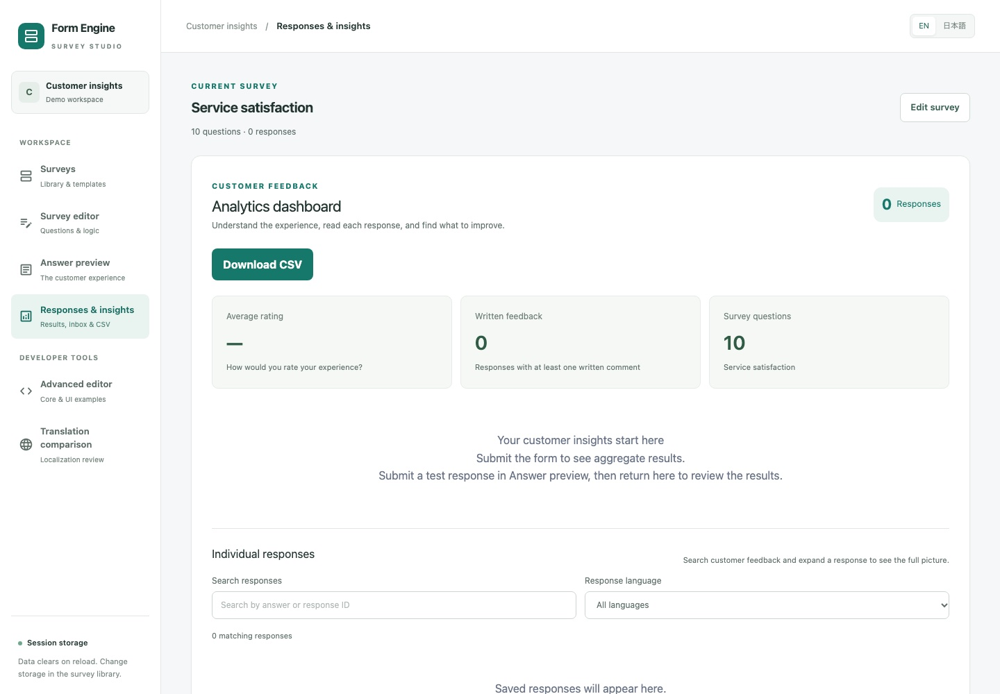
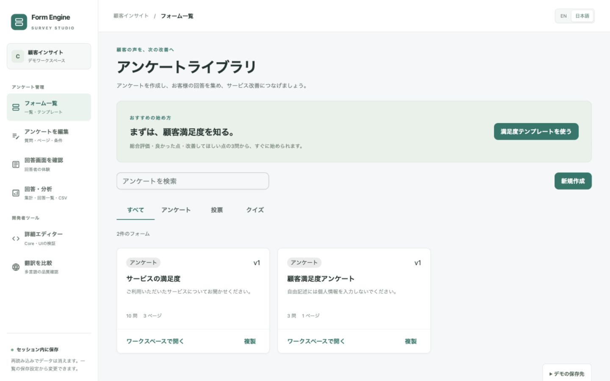

# form-engine-ts

[English](#english) · [日本語](#日本語)

## English

A schema-driven form engine for TypeScript and React. Build surveys, polls, and quizzes with a framework-independent Core, accessible UI components, and interchangeable storage and translation adapters.

### Features

- Define typed schemas with validation, conditional questions, and multi-page navigation.
- Build and render forms with React or MUI; customize the UI with hooks and slots.
- Start from templates, localize form content, and optionally let respondents resume saved drafts.
- Save versioned forms and responses; manage acceptance windows and response limits separately.
- Aggregate responses, export CSV, and analyze interaction funnels without collecting answer values in telemetry by default.
- Review and apply AI-generated drafts through injected adapters and Core validation.

### Quick start

```bash
pnpm add @form-engine-ts/core @form-engine-ts/react @form-engine-ts/translator-mock react react-dom
```

```tsx
import type { FormSchema } from "@form-engine-ts/core";
import { FormProvider, FormRenderer } from "@form-engine-ts/react";
import "@form-engine-ts/react/styles.css";
import { mockTranslator } from "@form-engine-ts/translator-mock";

const schema: FormSchema = {
  id: "feedback",
  version: 1,
  title: "Feedback",
  fields: [{ id: "comment", type: "textarea", title: "Your feedback", required: true }]
};

export function FeedbackForm() {
  return (
    <FormProvider
      schema={schema}
      locale="en"
      translator={mockTranslator}
      onSubmit={async (values) => console.log(values)}
    >
      <FormRenderer />
    </FormProvider>
  );
}
```

`FormProvider` validates the schema and answers; hidden answers are excluded from submission. Replace the example's console output with your application's save handler. Use `FormBuilder` to edit the same schema, or `ContentRenderer` for poll and quiz flows. See the [React guide](packages/react/README.md) for configuration and examples.

### Choose packages

Install only what your application needs. Package names use the `@form-engine-ts/` prefix; each link opens its API and setup guide.

| Purpose | Packages |
| --- | --- |
| Schemas, validation, submissions, analytics, CSV | [core](packages/core/README.md) |
| React provider, renderer, builder, hooks | [react](packages/react/README.md) |
| Material UI components | [mui](packages/mui/README.md) |
| Survey editor, translation, version management, response summaries | [custom-survey-client](packages/custom-survey-client/README.md) |
| Storage contracts and testing utilities | [storage](packages/storage/README.md) |
| In-memory or browser storage | [storage-memory](packages/storage-memory/README.md), [storage-localstorage](packages/storage-localstorage/README.md) |
| Database storage | [storage-mongodb](packages/storage-mongodb/README.md), [storage-postgres](packages/storage-postgres/README.md), [storage-sqlite](packages/storage-sqlite/README.md), [storage-d1](packages/storage-d1/README.md), [storage-azure-table](packages/storage-azure-table/README.md) |
| UI translation and demos | [translator-i18next](packages/translator-i18next/README.md), [translator-mock](packages/translator-mock/README.md) |
| Server-side text translation | [translator-azure](packages/translator-azure/README.md), [translator-deepl](packages/translator-deepl/README.md), [translator-google](packages/translator-google/README.md), [translator-google-v3](packages/translator-google-v3/README.md) |
| Translation caching | [translator-cache](packages/translator-cache/README.md) |
| Sensitive-data detection | [privacy](packages/privacy/README.md) |
| Zod 4 validation | [zod](packages/zod/README.md) |

### Demo

Run `pnpm dev` from this repository, then open the URL printed by Vite.

1. Select or create a form in **Surveys**; choose survey, poll, or quiz.
2. Open it in the workspace and edit questions, pages, and translations.
3. Save the schema and try **Answer preview**.
4. Review **Responses & insights**, search responses, and export CSV.



<details>
<summary>Editor, respondent flow, and analytics screenshots</summary>

Edit questions alongside a live preview.



Check the customer-facing answer screen.



Try a multilingual, multi-page respondent form.



Search and filter responses, inspect analytics, and export CSV.



</details>

Memory storage clears on reload; LocalStorage keeps data in this browser. AI features use mock adapters by default. The demo does not publish forms or issue public response URLs; production identity and access control belong in your application.

### Integration notes

- Core is framework-independent; React supports SSR. Inject a storage implementation when using the LocalStorage adapter outside a browser.
- Store schema content per version and current runtime settings per form. Recheck acceptance windows and response limits at server-side submission.
- Keep database connections, authorization, and translation/AI credentials in your application. Send only bounded form context to AI providers, exclude response data, and persist only validated, approved changes. See the [server-side authoring example](examples/azure-openai-authoring/README.md).

### Development

Requires **Node.js >=22.22.2** and **pnpm 11**.

```bash
pnpm install --frozen-lockfile
pnpm dev
```

Run repository checks before submitting changes:

```bash
pnpm lint
pnpm typecheck
pnpm build
pnpm test
```

For a focused check, use `pnpm --filter @form-engine-ts/core test` (replace the package as needed). Release history is in [RELEASE_NOTES.md](RELEASE_NOTES.md). License: [MIT](LICENSE).

## 日本語

TypeScriptとReact向けのスキーマ駆動フォームエンジンです。フレームワーク非依存のCore、アクセシブルなUI、差し替え可能な保存・翻訳アダプターを組み合わせて、アンケート・投票・クイズを作成できます。

### 主な機能

- 型付きスキーマによる入力検証、条件付き設問、複数ページのフォーム。
- React・MUIによる編集／回答画面と、フック・スロットによるUIのカスタマイズ。
- テンプレートからの作成、多言語対応、任意で有効にする回答下書きの保存・再開。
- フォームと回答のバージョン管理、版とは別に管理する受付期間・回答数上限。
- 回答集計、CSV出力、既定では回答値を収集しない操作イベントによるファネル分析。
- アダプターを通じたAI下書きの生成と、Coreの検証を経た確認・適用。

### はじめる

```bash
pnpm add @form-engine-ts/core @form-engine-ts/react @form-engine-ts/translator-mock react react-dom
```

```tsx
import type { FormSchema } from "@form-engine-ts/core";
import { FormProvider, FormRenderer } from "@form-engine-ts/react";
import "@form-engine-ts/react/styles.css";
import { mockTranslator } from "@form-engine-ts/translator-mock";

const schema: FormSchema = {
  id: "feedback",
  version: 1,
  title: "ご意見",
  fields: [{ id: "comment", type: "textarea", title: "ご意見をお聞かせください", required: true }]
};

export function FeedbackForm() {
  return (
    <FormProvider
      schema={schema}
      locale="ja"
      translator={mockTranslator}
      onSubmit={async (values) => console.log(values)}
    >
      <FormRenderer />
    </FormProvider>
  );
}
```

`FormProvider`がスキーマと回答を検証し、非表示の設問の回答を送信対象から除外します。例のコンソール出力を、アプリケーションの保存処理へ置き換えてください。`FormBuilder`で同じスキーマを編集し、投票・クイズには`ContentRenderer`を利用できます。設定や使用例は[Reactガイド](packages/react/README.md)を参照してください。

### パッケージを選ぶ

必要なパッケージだけを導入できます。パッケージ名の接頭辞は`@form-engine-ts/`です。各リンク先にAPIと設定方法を記載しています。

| 用途 | パッケージ |
| --- | --- |
| スキーマ・検証・回答データ・集計・CSV | [core](packages/core/README.md) |
| ReactのProvider・回答画面・Builder・フック | [react](packages/react/README.md) |
| Material UIコンポーネント | [mui](packages/mui/README.md) |
| アンケート編集・翻訳・版管理・回答サマリー | [custom-survey-client](packages/custom-survey-client/README.md) |
| 保存の共通契約・テスト用ユーティリティ | [storage](packages/storage/README.md) |
| メモリー・ブラウザーへの保存 | [storage-memory](packages/storage-memory/README.md), [storage-localstorage](packages/storage-localstorage/README.md) |
| データベースへの保存 | [storage-mongodb](packages/storage-mongodb/README.md), [storage-postgres](packages/storage-postgres/README.md), [storage-sqlite](packages/storage-sqlite/README.md), [storage-d1](packages/storage-d1/README.md), [storage-azure-table](packages/storage-azure-table/README.md) |
| UI翻訳・デモ用翻訳 | [translator-i18next](packages/translator-i18next/README.md), [translator-mock](packages/translator-mock/README.md) |
| サーバー側のテキスト翻訳 | [translator-azure](packages/translator-azure/README.md), [translator-deepl](packages/translator-deepl/README.md), [translator-google](packages/translator-google/README.md), [translator-google-v3](packages/translator-google-v3/README.md) |
| 翻訳キャッシュ | [translator-cache](packages/translator-cache/README.md) |
| 機密データの検出 | [privacy](packages/privacy/README.md) |
| Zod 4による検証 | [zod](packages/zod/README.md) |

### デモ

このリポジトリで`pnpm dev`を実行し、Viteが表示するURLを開きます。

1. **フォーム一覧**でアンケート・投票・クイズを選択、または新規作成します。
2. ワークスペースで開き、設問・ページ・翻訳を編集します。
3. スキーマを保存して、**回答画面を確認**で回答を試します。
4. **回答・分析**で回答を検索・集計し、CSVを出力します。



<details>
<summary>編集・回答・分析画面のキャプチャ</summary>

プレビューを見ながら設問を編集できます。


回答者に見える画面を確認できます。


多言語・複数ページのフォームも試せます。


回答の検索・言語による絞り込み・集計・CSV出力を確認できます。


</details>

Memoryのデータは再読み込みで消え、LocalStorageはこのブラウザーに保存します。AI機能は既定でモックを利用します。デモはフォームの外部公開や公開回答URLの発行を行いません。本番の回答者識別と権限制御はアプリケーション側で実装してください。

### 組み込み時の注意点

- Coreはフレームワーク非依存、ReactはSSRに対応します。ブラウザー外でLocalStorageアダプターを使う場合は保存実装を注入してください。
- スキーマの内容は版ごと、現在の受付設定はフォームごとに保存します。送信時にはサーバー側で受付期間と回答数上限を再確認してください。
- データベース接続・認可・翻訳／AIの認証情報はアプリケーション側で管理します。AIには必要な範囲のフォーム情報だけを送り、回答データを含めず、検証・承認した変更だけを保存してください。[サーバー側のAI編集例](examples/azure-openai-authoring/README.md)を参照できます。

### 開発

**Node.js >=22.22.2**と**pnpm 11**が必要です。

```bash
pnpm install --frozen-lockfile
pnpm dev
```

変更時はリポジトリ全体のチェックを実行します。

```bash
pnpm lint
pnpm typecheck
pnpm build
pnpm test
```

個別の確認には`pnpm --filter @form-engine-ts/core test`を使います。対象パッケージ名は適宜変更してください。更新履歴は[RELEASE_NOTES.md](RELEASE_NOTES.md)、ライセンスは[MIT](LICENSE)を参照してください。
